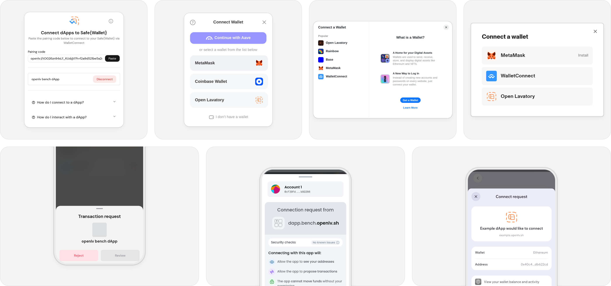

<picture>
  <source media="(prefers-color-scheme: dark)" srcset=".github/assets/grid-dark.png">
  <source media="(prefers-color-scheme: light)" srcset=".github/assets/grid-light.png">
  
</picture>

# ecosystem

<table>
  <tr>
    <td width="415" height="80" valign="bottom"><a href="patches/safe-wallet-web"><b>Safe{Wallet}</b></a>  Web
<a href="patches/safe-wallet-web">patch</a>&emsp;<a href="https://github.com/safe-global/safe-wallet-monorepo/tree/35070b7353c03fe1007f04b48f58cd0ca2afe00e">source</a>
</td>
    <td width="415" height="80" valign="bottom"><a href="patches/safe-wallet-mobile"><b>Safe{Wallet}</b></a>  Mobile
<a href="patches/safe-wallet-mobile">patch</a>&emsp;<a href="https://github.com/safe-global/safe-wallet-monorepo/tree/35070b7353c03fe1007f04b48f58cd0ca2afe00e">source</a>
</td>
  </tr>
  <tr>
    <td width="415" height="80" valign="bottom"><a href="patches/connectkit"><b>ConnectKit</b></a>  SDK
<a href="patches/connectkit">patch</a>&emsp;<a href="https://github.com/family/connectkit/tree/5d2630982e732d5b8bd7da0cb29a810a61fb99cb">source</a>
</td>
    <td width="415" height="80" valign="bottom"><a href="patches/rainbowkit"><b>RainbowKit</b></a>  SDK
<a href="patches/rainbowkit">patch</a>&emsp;<a href="https://github.com/rainbow-me/rainbowkit/tree/03360ee924cfa6af13ff1d623b356bf5a170348e">source</a>
</td>
  </tr>
  <tr>
    <td width="415" height="80" valign="bottom"><a href="patches/cake-wallet"><picture><source media="(prefers-color-scheme: dark)" srcset=".github/assets/apps/cake-wallet-dark.svg"></picture></a><a href="patches/cake-wallet"><b>Cake Wallet</b></a>  Mobile
<a href="patches/cake-wallet">patch</a>&emsp;<a href="https://github.com/cake-tech/cake_wallet/tree/8a81db52bca62ee372eda34b2357db2afb5acd15">source</a>
</td>
    <td width="415" height="80" valign="bottom"><a href="patches/ens-apps"><b>ENS apps</b></a>  Web
<a href="patches/ens-apps">patch</a>&emsp;<a href="https://github.com/ensdomains/apps-monorepo/tree/48ea17b253def0528e26d2a6e2f7a9c36596ebb4">source</a>
</td>
  </tr>
</table>
